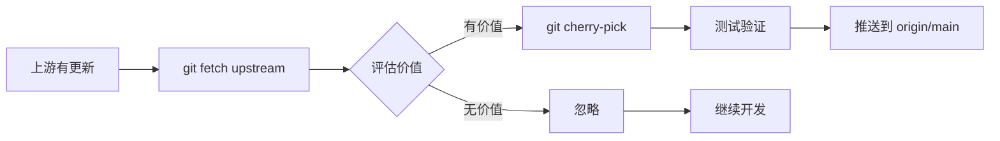

# TuPigPlay 零跑 C11 2024 (8295P) 适配项目 - 交接文档

> **项目状态**：核心架构完成 ~85%，**但当前代码无法编译**（84 处残留引用，详见「🔴 编译阻塞项」）
> **最后更新**：2026-10-12（文档 v1.3）
> **当前分支**：`main`（接手前先执行 `git pull` 同步本文档）
> **远程仓库**：https://github.com/Tupig/DiPlay（独立维护，禁止回推上游）

---

## 🧭 接手必读（30 秒导航）

| 你想做什么 | 看哪一节 |
|-----------|---------|
| **代码为什么编不过？怎么修？** | [🔴 编译阻塞项](#-编译阻塞项已用-grep-核实接手后第一优先级) ← **第一优先级** |
| 按什么顺序干活？ | [🎯 接手顺序](#-给下一个-agent 的建议接手顺序务必按此优先级) |
| 项目整体进度？ | [📋 项目概况](#-项目概况) → [✅ 已完成](#-已完成核心工作-phase-1-3-7-完成-85) → [🔧 待完成](#-当前进行中--待完成任务) |
| 关键代码在哪？ | [📦 关键文件清单](#-关键文件清单-下一个-agent-必看) → [📁 目录结构](#-关键目录结构) |
| 有什么坑？ | [⚠️ 已知风险](#️已知风险注意事项) + [🔴 章节内的 4 个修复陷阱](#已确认的修复陷阱) |
| 要遵守什么规矩？ | [📋 强制性工作规范](#-强制性工作规范必须遵守)（Issue/Git/文档/CI） + [📚 文档规范](#-文档规范对标-githubdesktop2chinese强制) |
| 怎么同步上游？ | [🔄 上游同步工作流](#-上游同步工作流单向同步禁止回推) |
| 交接前 checklist | [✅ 入职 Checklist](#-下一个-agent-入职-checklist) |

---

## 📑 目录

1. [📋 项目概况](#-项目概况)
2. [✅ 已完成核心工作](#-已完成核心工作-phase-1-3-7-完成-85)
3. [🎨 锯齿与延迟优化](#-锯齿与延迟优化-最新完成-)
4. [🔴 编译阻塞项（第一优先级）](#-编译阻塞项已用-grep-核实接手后第一优先级)
5. [🔧 当前进行中 / 待完成任务](#-当前进行中--待完成任务)
6. [📦 关键文件清单](#-关键文件清单-下一个-agent-必看)
7. [🚀 行动清单](#-下一个-agent-立即可执行的行动清单)
8. [📁 关键目录结构](#-关键目录结构)
9. [⚠️ 已知风险 / 注意事项](#️已知风险注意事项)
10. [📞 关键联系 / 参考](#-关键联系参考)
11. [📋 强制性工作规范](#-强制性工作规范必须遵守)
12. [✅ 入职 Checklist](#-下一个-agent-入职-checklist)
13. [🔄 上游同步工作流](#-上游同步工作流单向同步禁止回推)
14. [📚 文档规范（对标 GitHubDesktop2Chinese）](#-文档规范对标-githubdesktop2chinese强制)
15. [🎯 接手顺序与建议](#-给下一个-agent 的建议接手顺序务必按此优先级)

---

## 📋 项目概况

| 项目 | 详情 |
|------|------|
| **项目名称** | TuPigPlay (原 DiPlay) |
| **目标车型** | 零跑 C11 2024/2025 款 (8295P 芯片) |
| **屏幕配置** | 中控 14.6" 2560×1600 + 仪表 12.3" 1920×720 + 副驾娱乐屏 |
| **系统版本** | LeapOS 3.21.40+ |
| **安装方式** | U 盘安装 + 白名单包名 (喜马拉雅/B站/QQ音乐车机版) |
| **ADB 状态** | **已开启** (用户已确认)，可使用 ADB 相关功能 |

---

## ✅ 已完成核心工作 (Phase 1-3, 7 完成 ~85%)

### Phase 1: 核心构建系统 ✅
- [x] 白名单包名构建支持 (`-PtupigplayApplicationId`)
- [x] 构建脚本 `build_leapmotor.sh` 一键构建
- [x] 版本自动递增 (`version.properties` + `version_increment.sh`)
- [x] 四段式版本号: `major.minor.patch.build` (当前 `0.0.0.1`)
- [x] 环境变量: `TUPIGPLAY_*` 替代 `DIPLAY_*`
- [x] APK 参考文件入库: `docs/apk-reference/`

### Phase 2: 零跑专用配置 ✅
| 文件 | 功能 |
|------|------|
| `leapmotor/LeapmotorC11Settings.kt` | 核心配置、白名单包名、硬件常量 |
| `leapmotor/LeapmotorVehicleInfo.kt` | 动态车型检测 (系统属性 > Build字段 > 专有属性 > 用户设置) |
| `leapmotor/LeapmotorDiagnostics.kt` | 诊断上报 |
| `leapmotor/LeapmotorInstallGuide.kt` | 安装引导向导 |
| `leapmotor/LeapmotorVehicleAccess.kt` | 车辆访问层 (支持 ADB) |
| `leapmotor/LeapmotorClusterBridge.kt` | 仪表盘桥接 |
| `leapmotor/LeapmotorVehicleCapabilities.kt` | 车辆能力描述 |
| `leapmotor/LeapmotorVehicleDataStore.kt` | 车辆数据存储 |
| `leapmotor/LeapmotorVehicleField.kt` | 车辆数据字段定义 |
| `leapmotor/LeapmotorCarPlayCall.kt` | 通话处理 |
| `leapmotor/LeapmotorOutputSettings.kt` | 输出设置 |
| `leapmotor/LeapmotorWheelKeys.kt` | 方向盘按键映射 |
| `leapmotor/LeapmotorClusterLayout.kt` | 仪表盘布局 (新增 COPILOT 主题) |
| `cluster/CopilotDisplayPresentation.kt` | 副驾屏显示支持 |

### Phase 3: 方向盘按键完全适配 ✅
- [x] `wheel/LeapmotorWheelKeys.kt` 零跑专用按键映射
- [x] `WheelKeyService.kt` 集成零跑键值
- [x] `wheel/LeapmotorWheelKeySettingsSection.kt` 设置界面 (预设/学习/开关/映射/重置)

### Phase 7: BYD 代码清理 + 重命名 ✅
- [x] 删除 38 个 `shared/hud/Byd*.kt` + 4 个 BYD 文档
- [x] 批量替换 219 个 XML: `BYD/byd/比亚迪` → `Leapmotor/leapmotor/零跑`
- [x] 批量替换代码: `DiPlay` → `TuPigPlay`
- [x] 更新所有 import 路径指向新包结构
- [x] GitHub 链接: `shihabal3amri/DiPlay` → `Tupig/DiPlay`

### 代码目录重构 ✅
```
common/src/main/java/com/shilapi/xcertplay/
├── leapmotor/     # 零跑专用配置
├── cluster/       # 仪表盘显示
├── airplay/       # CarPlay 核心
├── diagnostics/   # 诊断日志
├── vehicle/       # 车辆能力/数据
├── wheel/         # 方向盘按键
├── usb/           # USB 充电/权限
├── media/         # 环境光/音频
├── navigation/    # 导航/地图
├── telecom/       # 蓝牙/通话
├── transport/     # 传输层
├── bluetooth/     # 蓝牙相关
├── carplay/       # 车机集成
├── core/          # 核心 Activity
├── settings/      # 设置界面
├── setup/         # 设置向导
├── update/        # 版本更新
├── bluetooth/     # 蓝牙相关
```

---

## 🎨 锯齿与延迟优化 (最新完成) ✅

| 优化项 | 变更前 | 变更后 | 预期效果 |
|--------|--------|--------|----------|
| **抗锯齿** | 无 | `setForceAntiAliasing(true)` + `FilterQuality.HIGH` + `LAYER_TYPE_HARDWARE` | 画面边缘平滑 |
| **Smooth Video 延迟** | 40+3000/fps (90ms@60fps) | 20+2000/fps (45ms@60fps) | **降低 50%** |
| **全局低延迟** | 无 | 新增 `lowLatencyVideoDelayMillis` (10+1000/fps) | 非smooth模式也低延迟 |
| **硬件加速** | 无 | `setLayerType(LAYER_TYPE_HARDWARE)` | GPU渲染加速 |

**修改文件**：
- `CarPlayHostActivity.kt` - 主视频 TextureView、延迟配置
- `ClusterMapPresentation.kt` - 仪表盘 TextureView
- `CopilotDisplayPresentation.kt` - 副驾屏 TextureView
- `CarPlayVideoSurface.kt` - 延迟计算函数

---

## 🔴 编译阻塞项（已用 grep 核实，接手后第一优先级）

> ⚠️ **数据已核实（2026-10-12）**：`common/src/main/.../hud/` 目录已删空（0 文件），但全仓库仍有 **84 处 `com.shilapi.xcertplay.hud.Byd*` 引用，分布在 34 个 .kt 文件**，全部指向已删除的类 → **当前代码必定编译失败**。
>
> 核实命令：`git grep -n "com.shilapi.xcertplay.hud.Byd" -- "*.kt"`

### 受影响文件（34 个，按引用数排序）

| 模块/文件 | 引用数 |
|-----------|--------|
| `common/.../airplay/CarPlayHostActivity.kt` | 25 |
| `common/src/test/.../BydVehicleDataSettingsTest.kt` | 10 |
| `common/.../carplay/AdbClusterActivity.kt` | 4 |
| `common/src/test/.../BydSettingsReconnectTest.kt` | 4 |
| `common/.../core/DiPlayActivity.kt` | 3 |
| `common/src/test/.../BydAdbSettingsUiTest.kt` | 3 |
| `common/src/test/.../CarHotspotSwitchTest.kt` | 3 |
| `common/.../carplay/AdbClusterRouter.kt` | 2 |
| `common/src/test/.../CarPlayCallControlsOptInTest.kt` | 2 |
| `common/src/test/.../WheelKeyServiceTest.kt` | 2 |
| `shared/.../media/AmbientMusicController.kt` | 2 |
| `shared/.../orchestration/CarPlayController.kt` | 2 |
| 其余 22 个文件（各 1 处） | 22 |

<details>
<summary>其余 22 个文件完整清单（点开查看）</summary>

- `common/.../airplay/AirPlayPersistence.kt`
- `common/.../cluster/ClusterMapPresentation.kt`
- `common/.../cluster/ClusterSpeedometerView.kt`
- `common/.../core/DiPlaySessionService.kt`
- `common/src/test/.../BydCallPopupLifecycleTest.kt`
- `common/src/test/.../CarHotspotSetupTest.kt`
- `common/src/test/.../CarPlayControllerUsbServiceTest.kt`
- `common/src/test/.../CarPlayHostDisplaySizeTest.kt`
- `common/src/test/.../CarProfileRuntimeTest.kt`
- `common/src/test/.../ClusterMapPresentationTest.kt`
- `common/src/test/.../DiPlayAuthenticationTest.kt`
- `common/src/test/.../OemLabelTest.kt`
- `common/src/test/.../SmoothVideoHostLifecycleTest.kt`
- `common/src/test/.../WheelMediaKeyWindowTest.kt`
- `common/src/test/.../WheelSiriWindowTest.kt`
- `shared/.../glance/CarPlayGlance.kt`
- `shared/.../media/AmbientLampSession.kt`
- `shared/.../media/AndroidMediaSink.kt`
- `shared/.../network/WifiScanPause.kt`
- `shared/.../telecom/PhoneAudioRoute.kt`
- `shared/src/test/.../glance/CarPlayGlanceTest.kt`
- `shared/src/test/.../media/AmbientLampSessionTest.kt`

</details>

### 被引用的 24 个已删除类（按频次）

| 已删除类 | 引用数 | 是否有 Leapmotor 替代 |
|----------|--------|----------------------|
| `BydNavigationOutputs` | 18 | ✅ `leapmotor/LeapmotorNavigationOutputs.kt`（已存在） |
| `BydOutputSettings` | 16 | ✅ `leapmotor/LeapmotorOutputSettings.kt` |
| `BydOemClusterNavi` | 6 | ⚠️ 未找到同名替代，需查 `LeapmotorClusterBridge`/`LocalizedOptions` |
| `BydClusterNaviMode` | 6 | ✅ `LeapmotorClusterNaviMode`（`LocalizedOptions.kt:71` 有 typealias） |
| `BydCarPlayCall` | 4 | ✅ `leapmotor/LeapmotorCarPlayCall.kt` |
| `BydTyreStatus` | 4 | ❌ 未找到，需新建或改造 |
| `BydVehicleFieldStore` | 4 | ✅ 可能对应 `LeapmotorVehicleDataStore.kt` |
| `BydAmbientLightPolicy` | 3 | ❌ 未找到 |
| `BydAdbAccess` | 3 | ⚠️ 查 `LeapmotorVehicleAccess.kt` |
| `BydVehicleProbeOutcome` | 2 | ❌ 未找到 |
| `BydCallPopupGuard` | 2 | ⚠️ `shared/hud/BydCallPopupLease.java` 仍在（见下方陷阱） |
| `BydHudRouteState` | 2 | ❌ 未找到 |
| `BydVehicleCapabilities` | 2 | ✅ `leapmotor/LeapmotorVehicleCapabilities.kt` |
| `BydBluetoothSuspend` | 2 | ⚠️ `shared/hud/BluetoothSuspendLease.kt` 仍在 |
| 其余 10 个类（各 1 处） | 10 | `BydClusterSpeedReader`、`BydAmbientLightClient`、`BydAdbShell`、`BydBatteryStatus`、`BydFieldProbeResult`、`BydOemClusterHold`（typealias 已有）、`BydBootStartRepair`、`BydVehicleField`、`BydReadAddress`、`BydFieldSource` |

### 已确认的修复陷阱

| 陷阱 | 说明 |
|------|------|
| ❌ **typealias 救不了全限定名** | `LocalizedOptions.kt:71,74` 虽有 `typealias BydClusterNaviMode = LeapmotorClusterNaviMode`，但它在 `com.shilapi.xcertplay` 包；引用写的是 `com.shilapi.xcertplay.hud.BydClusterNaviMode`（带 `.hud` 前缀）→ **全限定引用依然解析失败** |
| ❌ **不能盲目批量 Byd→Leapmotor** | 类名不一一对应（如 `BydVehicleFieldStore` → `LeapmotorVehicleDataStore`），必须逐类映射 |
| ❌ **包路径也要改** | `DiPlayActivity.kt:365` 已出现半改状态：`com.shilapi.xcertplay.hud.LeapmotorNavigationOutputs`（类名改了、包路径还留在 `hud`）→ 同样编译失败 |
| ⚠️ **hud 包未删空** | `shared/src/main/.../hud/` 仍有 15 个文件（含 `BydCallPopupLease.java`、`BydCallPopupTool.java` 两个 Byd 前缀 Java 文件），`shared/src/test/.../hud/` 还有 46 个 `Byd*Test.kt` 引用已删类 |
| ⚠️ **测试文件名仍带 Byd** | `common/src/test/` 下有 `BydAdbSettingsUiTest.kt` 等 5 个文件类名未改 |

### 推荐修复步骤

```bash
# 1. 先生成完整引用清单，逐条过
git grep -n "com.shilapi.xcertplay.hud.Byd" -- "*.kt"

# 2. 建立 24 个类的映射表（已删除类 → leapmotor/ 或新建），无替代的先建空壳
#    原则：优先改用 leapmotor/ 现有类；功能确实需要的补实现；纯测试的先 @Ignore

# 3. 逐文件替换（禁止无脑全局替换），每改 5 个文件尝试编译一次

# 4. 处理 shared/src/test/.../hud/ 的 46 个 Byd*Test.kt：
#    引用已删类的先 @Ignore("类已迁移至 leapmotor 包")，后续按 Phase 7 清理

# 5. 全部改完后清理 LocalizedOptions.kt 中失效的 typealias
```

### 验收标准

```bash
git grep -c "com.shilapi.xcertplay.hud.Byd" -- "*.kt"   # 必须输出 0 条
./build_leapmotor.sh ximalaya                             # 构建通过
```

### 其他已核实的编译问题（调查中断，接手后需继续排查）

| 问题 | 核实结果 |
|------|----------|
| **目录与 package 不一致** | `leapmotor/LeapmotorClusterLayout.kt` 第 2 行是 `package com.shilapi.xcertplay`（非 `.leapmotor`）；`airplay/CarPlayHostActivity.kt` 第 1 行也是 `package com.shilapi.xcertplay`（非 `.airplay`）→ 目录重构时只移了文件、没改 package |
| **import 路径找不到类** | `ClusterMapPresentation.kt:28` 写的是 `import com.shilapi.xcertplay.cluster.LeapmotorClusterLayout`，但类实际声明在 `com.shilapi.xcertplay` 包 → 编译失败 |
| **重复定义** | `LeapmotorClusterLayout.kt` 内 `enum class Theme` 出现 **2 次**、`fun automatic` 出现 **2 次**（重构时正则改了两遍）→ 编译失败 |
| **中文乱码** | `LeapmotorClusterLayout.kt` 枚举标签已乱码：`FULL_MAP("鍏ㄥ睆鍦板浘 路 Full Map")` → 文件编码损坏，需从 git 历史恢复正确中文 |

> ⚠️ **上述问题仅是抽查 2 个文件的结果**，建议接手后系统性检查：所有 `*/leapmotor/*.kt`、`*/cluster/*.kt` 等移动过文件的 package 声明与 import 是否一致（目录重构涉及 102 个文件，commit `dcec5740`）。

---

## 🔧 当前进行中 / 待完成任务

### Phase 4: 三屏显示适配 (进行中 ~70%)

| 子任务 | 状态 | 说明 |
|--------|------|------|
| 4.1 中控屏 2560×1600 @60fps | ✅ | 已支持原生渲染 + 抗锯齿 |
| 4.2 仪表盘 12.3" 投屏 | ✅ | ClusterMapPresentation + LeapmotorClusterLayout |
| 4.3 副驾屏娱乐屏 | 🔄 **70%** | CopilotDisplayPresentation 已创建，**需集成到 CarPlayHostActivity** |
| 4.4 安全区域适配 | ⏳ | 圆角、挖孔、仪表遮挡 |
| 4.5 分屏/画中画模式 | ⏳ | SplitScreenSettings + CarPlayRotation |

**下一步关键动作**：
```kotlin
// 在 CarPlayHostActivity.ensureClusterPresentation() 中已添加 COPILOT 分支
// 需要完善：
private fun ensureCopilotPresentation() {
    if (copilotPresentation != null) return
    val display = CopilotDisplayPresentation.findDisplay(this) ?: return
    val presentation = CopilotDisplayPresentation(this, display) { surface ->
        runOnUiThread { copilotSurface = surface }
    }
    // ... 已实现基础逻辑
}
```

### Phase 5: ADB 功能优化 (零跑有 ADB) ⏳

| 任务 | 优先级 | 说明 |
|------|--------|------|
| 5.1 热点管理：ADB 启动内置热点 | P0 | `LeapmotorVehicleAccess` 已支持 ADB |
| 5.2 USB 自动确认：ADB 辅助服务 | P0 | `UsbAutoConfirmService` 需适配 ADB |
| 5.3 仪表盘速度计：ADB 读取车速 | P0 | `LeapmotorVehicleAccess.getVehicleSpeed()` 需实现 |
| 5.4 设置备份：ADB 备份通道 | P1 | 补充 ADB 备份通道 |
| 5.5 保留 ADB 相关功能 | P0 | 已确认零跑 ADB 可用 |

### Phase 6: 文档合并为中英双语单文件 ⏳

| 文档 | 状态 |
|------|------|
| `LEAPMOTOR.md` + `LEAPMOTOR.zh-CN.md` → `LEAPMOTOR.md` | ⏳ |
| `INSTALL.md` + `INSTALL.zh-CN.md` → `INSTALL.md` | ⏳ |
| `LEAPMOTOR_C11_2024_INSTALL.zh-CN.md` → 双语版 | ⏳ |
| 删除所有 `.zh-CN.md` | ⏳ |
| 参考风格：https://github.com/Tupig/GitHubDesktop2Chinese | - |

### Phase 8: 构建验证 ⏳

| 任务 | 说明 |
|------|------|
| 8.1 完整构建 Release APK | 版本自增已就绪 (`version_increment.sh`) |
| 8.2 验证包名、签名、安装 | 包名 `com.tupig.tupigplay` |
| 8.3 真机测试核心流程 | 无线/有线 CarPlay、方向盘、三屏 |
| 8.4 生成最终交付物 | Release APK + 文档 |
| 8.5 推送到主库 | 自动版本号递增 |

---

## 📦 关键文件清单 (下一个 Agent 必看)

### 核心配置
- `mobile/build.gradle.kts` - 包名 `com.tupig.tupigplay`、版本 `0.0.0.1`、环境变量 `TUPIGPLAY_*`
- `version.properties` + `version_increment.sh` - 版本自增机制
- `build_leapmotor.sh` - 一键构建脚本

### 核心逻辑
- `leapmotor/LeapmotorC11Settings.kt` - 零跑 C11 核心配置
- `leapmotor/LeapmotorVehicleInfo.kt` - 动态车型检测
- `leapmotor/LeapmotorVehicleAccess.kt` - 车辆访问 (支持 ADB)
- `leapmotor/LeapmotorClusterLayout.kt` - 仪表盘布局 (含 COPILOT 主题)
- `cluster/ClusterMapPresentation.kt` - 仪表盘投屏 (已加抗锯齿)
- `cluster/CopilotDisplayPresentation.kt` - **副驾屏显示 (需集成)**
- `airplay/CarPlayHostActivity.kt` - CarPlay 核心宿主 (已加抗锯齿/低延迟)
- `cluster/CopilotDisplayPresentation.kt` - 副驾屏显示

### 优化相关
- `CarPlayVideoSurface.kt` - `smoothVideoDelayMillis` / `lowLatencyVideoDelayMillis`
- `cluster/ClusterMapPresentation.kt` - 仪表盘抗锯齿
- `cluster/CopilotDisplayPresentation.kt` - 副驾屏抗锯齿

---

## 🚀 下一个 Agent 立即可执行的行动清单

### 立即执行 (P0)
1. **修复编译**（最大阻塞）— 按「🔴 编译阻塞项」章节处理 84 处 `hud.Byd*` 残留引用 + 目录/package 不一致 + 重复定义，直到 `./build_leapmotor.sh ximalaya` 通过
2. **完善副驾屏集成** - 在 `CarPlayHostActivity.ensureClusterPresentation()` 中完善 `Theme.COPILOT` 分支
3. **真机测试副驾屏** - 验证 `CopilotDisplayPresentation.findDisplay()` 能否发现副驾屏

### 短期完成 (P1)
1. **Phase 5 ADB 功能** - 实现 `LeapmotorVehicleAccess.getVehicleSpeed()` 等 ADB 读取
2. **完善副驾屏设置** - 在设置界面添加副驾屏开关、内容选择
3. **Phase 6 文档合并** - 双语文档合并 + 按「📚 文档规范」补齐 README/.github

### 中期完成 (P2)
1. **Phase 8 构建验证** - 运行 `./build_leapmotor.sh ximalaya` 构建 Release APK
2. **真机全流程测试** - 无线/有线 CarPlay、方向盘按键、三屏显示、锯齿/延迟体验

---

## 📁 关键目录结构

```
H:\DiPlay-Merge\main-repo\
├── mobile\build.gradle.kts           # 移动端构建配置
├── version.properties                 # 版本号配置
├── version_increment.sh               # 版本自增脚本
├── build_leapmotor.sh                 # 一键构建脚本
├── docs\apk-reference\               # 参考 APK (PaopaoDesktop + DiPlay-gallery)
├── common\src\main\java\com\shilapi\xcertplay\
│   ├── leapmotor\                     # 零跑专用核心
│   ├── cluster\                       # 仪表盘 + 副驾屏
│   ├── airplay\                       # CarPlay 核心
│   ├── wheel\                         # 方向盘按键
│   ├── vehicle\                       # 车辆能力
│   └── ... (其他模块)
└── docs\                              # 文档 (需合并双语)
```

---

## ⚠️ 已知风险/注意事项

1. **网络不稳定** - GitHub 连接间歇性失败，推送需重试
2. **无 Java/模拟器环境** - 无法本地构建验证，需真机或 CI
3. **APK 签名** - 需配置 `local.properties` 中的 keystore 信息
4. **真机测试必需** - 锯齿/延迟/三屏/方向盘/ADB 必须实车验证
4. **白名单包名** - 构建时必须指定 `-PtupigplayApplicationId=com.ximalaya.ting.android.car` 等

---

## 📞 关键联系/参考

- **主仓库**：https://github.com/Tupig/DiPlay
- **参考 APK**：`docs/apk-reference/PaopaoDesktop-1.28.168-20002370.apk` (方向盘/仪表盘实现参考)
- **双语文档风格参考**：https://github.com/Tupig/GitHubDesktop2Chinese
- **白名单包名**：喜马拉雅 `com.ximalaya.ting.android.car` / B站 `com.bilibili.bilithings` / QQ音乐 `com.tencent.qqmusiccar`

---

## 📋 强制性工作规范 (必须遵守)

### 🐛 Issue 管理规范 (强制)

| 规则 | 说明 |
|------|------|
| **所有问题必须创建 Issue** | 任何 Bug、功能需求、技术债、优化建议都必须在 GitHub 创建 Issue，禁止仅在本地或聊天中记录 |
| **Issue 必填字段** | 标题(清晰描述)、Labels(类型/优先级/模块)、Assignees、Projects、Milestone |
| **Issue 模板** | 必须使用 `.github/ISSUE_TEMPLATE/` 下的模板：`bug_report.yml`、`feature_request.yml`、`task.yml` |
| **关联提交** | 所有 commit 必须在 message 中引用 Issue 编号：`fix: 修复锯齿问题 #123` |
| **关闭方式** | 通过 `Closes #123` 或 `Fixes #123` 在 PR/commit 中自动关闭 |

### 🔄 Git 工作流规范 (强制)

| 规则 | 说明 |
|------|------|
| **分支策略** | `main` (受保护) ← `feature/*` / `fix/*` / `chore/*` / `docs/*` / `refactor/*` |
| **分支命名** | `type/issue号-简短描述` 例：`feat/456-add-copilot-display` |
| **PR 规范** | 所有变更必须通过 PR 合并，禁止直接推送 `main` |
| **PR 模板** | 必须使用 `.github/PULL_REQUEST_TEMPLATE.md` |
| **Review 要求** | 至少 1 次 Code Review 通过后可合并 |
| **Commit 规范** | Conventional Commits：`type(scope): description` 例：`feat(cluster): add copilot display support` |

### 📝 文档规范

| 规则 | 说明 |
|------|------|
| **双语文档** | 所有用户文档必须中英双语单文件，参考 `GitHubDesktop2Chinese` 风格 |
| **API 文档** | KDoc 注释覆盖所有 public API |
| **架构决策记录** | 重要决策记录在 `docs/adr/YYYY-MM-DD-短标题.md` (ADR 格式) |

### 🏷️ 标签规范 (GitHub Labels)

| 类型 | 标签示例 |
|------|----------|
| **Type** | `type:bug`、`type:feature`、`type:task`、`type:chore`、`type:docs`、`type:refactor` |
| **Priority** | `priority:critical`、`priority:high`、`priority:medium`、`priority:low` |
| **Module** | `module:cluster`、`module:airplay`、`module:wheel`、`module:leapmotor`、`module:usb`、`module:bluetooth` |
| **Status** | `status:todo`、`status:in-progress`、`status:review`、`status:blocked`、`status:done` |

### 🔄 CI/CD 规范

| 规则 | 说明 |
|------|------|
| **自动构建** | 每次 PR 推送触发 Gradle 构建 + 单元测试 |
| **代码检查** | ktlint + detekt 必须通过 |
| **版本自增** | 合并到 main 自动执行 `version_increment.sh` 并打 Tag `v{version}` |
| **Release** | Tag 推送触发生成 Release APK + 自动生成 Changelog |

---

## ✅ 下一个 Agent 入职 Checklist

- [ ] 阅读完 `HANDOFF_NEXT_AGENT.md` 全文
- [ ] 配置 Git 用户信息：`git config user.name/email`
- [ ] 配置 GitHub CLI：`gh auth login`
- [ ] 熟悉 `.github/ISSUE_TEMPLATE/` 和 `.github/PULL_REQUEST_TEMPLATE.md`
- [ ] 创建第一个 Issue：`feat(cluster): complete copilot display integration`
- [ ] 开发分支：`git checkout -b feat/456-copilot-display-integration`
- [ ] 开始 Phase 4.3 副驾屏集成开发

---

## 🔄 上游同步工作流 (单向同步，禁止回推)

> **核心原则**：独立维护 TuPigPlay，**禁止贡献回上游**，但**保留监控上游更新**能力，有价值的更新由 Agent 评估后选择性合并。

### 🔧 远程仓库配置 (已完成)

| 远程名 | URL | 权限 | 说明 |
|--------|-----|------|------|
| `origin` | `https://github.com/Tupig/DiPlay.git` | 读写 | 你的主仓库 (TuPigPlay) |
| `upstream` | `https://github.com/shihabal3amri/DiPlay.git` | **只读** | 上游原项目 (已禁用 push) |

```bash
# 已配置完成：
git remote add upstream https://github.com/shihabal3amri/DiPlay.git
git remote set-url --push upstream "禁用推送到上游"  # 禁用误推
```

### 🔄 同步工作流 (Agent 必须掌握)



### 📋 标准操作流程 (Agent 必须掌握)

#### 1. 获取上游更新
```bash
cd /d H:\DiPlay-Merge\main-repo

# 获取上游最新代码
git fetch upstream

# 查看上游新提交 (不合并)
git log --oneline main..upstream/main

# 查看详细差异
git log --oneline --graph --all -20
```

#### 2. 评估价值 (Agent 必须评估)

| 评估维度 | 判断标准 |
|----------|----------|
| **功能相关性** | 是否与 TuPigPlay 功能相关 (CarPlay、方向盘、仪表盘、ADB等) |
| **兼容性** | 是否与零跑 C11 (8295P) 硬件兼容 |
| **代码质量** | 是否符合项目规范 (ktlint/detekt) |
| **维护成本** | 引入后维护成本是否可控 |

#### 3. 选择性合并 (有价值时)

```bash
# 创建临时评估分支
git checkout -b eval-upstream upstream/main

# 对比差异
git diff main..eval-upstream --stat

# 仅挑选有用的提交 (推荐 cherry-pick)
git checkout main
git cherry-pick <commit-hash>  # 仅挑选有用的

# 或合并特定文件
git checkout upstream/main -- path/to/valuable/file.kt
```

#### 4. 测试验证 (必须)

```bash
# 构建验证
./build_leapmotor.sh ximalaya

# 真机测试核心流程
# - 无线/有线 CarPlay 连接
# - 方向盘按键响应
# - 三屏显示 (中控/仪表/副驾)
# - 锯齿/延迟体验
# - ADB 功能 (热点/车速/USB确认)
```

#### 5. 推送到主仓库
```bash
git push origin main
```

### ⚠️ 禁止事项 (红线)

| 禁止操作 | 原因 |
|----------|------|
| ❌ `git push upstream` | 已禁用，防止误推送到上游 |
| ❌ 直接合并 `upstream/main` 到 `main` | 会引入大量不兼容的 BYD 代码 |
| ❌ 盲目合并所有上游提交 | 必须评估后选择性合并 |
| ❌ 修改上游仓库代码 | 无权限，且违背独立维护原则 |

### 📋 Agent 必须遵守的同步清单

- [ ] 定期 `git fetch upstream` (建议每周至少一次)
- [ ] 阅读上游 commit 信息，评估价值
- [ ] 有价值 → `git cherry-pick` 或文件级合并
- [ ] 无价值 → 记录原因，忽略
- [ ] 合并后 → 完整测试验证
- [ ] 推送到 `origin/main` (你的主仓库)
- [ ] 记录合并决策到 Issue/ADR

---

### ✅ 当前远程配置状态 (已验证)

| 远程名 | Fetch URL | Push URL | 状态 |
|--------|-----------|----------|------|
| `origin` | `https://github.com/Tupig/DiPlay.git` | `https://github.com/Tupig/DiPlay.git` | ✅ 读写 |
| `upstream` | `https://github.com/shihabal3amri/DiPlay.git` | `禁用推送到上游` | ✅ 只读 |

```bash
# 验证命令
git remote -v
```

输出应为：
```
origin    https://github.com/Tupig/DiPlay.git (fetch)
origin    https://github.com/Tupig/DiPlay.git (push)
upstream  https://github.com/shihabal3amri/DiPlay.git (fetch)
upstream  禁用推送到上游 (push)
```

### 🔄 同步评估记录（追加式日志，#11 例行）

> 每次例行巡检在此追加一节：日期 / 合并基 / 规模 / 分类结论 / 决策。

#### 2026-10-14 巡检

- **合并基**：`d9881b4a`（2026-10-12，上游 PR #660 cluster-music-card）。此前 2026-10-12/13 的两次直接合并违反本节红线（直接合并 upstream/main），其语义冲突已由 PR #18 修复；自本次巡检起严格按 cherry-pick 流程执行。
- **新增规模**：93 提交（48 非合并），2026-10-11 → 10-13；diff 150 文件，+6016/−631。上游正在准备 0.2.19 公测版。
- **高价值候选**（CarPlay / 视频 / 蓝牙核心健壮性，下次同步优先 cherry-pick）：
  - `f5366138` HEVC 无硬解时回退 H.264
  - `5e8a6f9a` 有线会话残留后重新询问 CarPlay 模式
  - `d0556a2f` FFmpeg-backed Codec2 解码改用 SurfaceView 输出
  - `54116013` BluetoothManager 为空时回退 BluetoothAdapter.getDefaultAdapter
  - `5fbd7171` 无线启动改 Wi-Fi 前检查蓝牙已开启
  - `59c26525` 有线 USB 授权在系统页缺失时的修复
  - `b5f1bfe4` 倒车影像隐藏状态栏时保持会话
  - `301c5601` SurfaceView 输出恢复时显示最后一帧 CarPlay 画面
  - `9647d689` 语音消息打开麦克风 + 无音频返回时自动重启
- **中价值候选**：诊断报告增强（`5b6dead5` 记录上次崩溃、`d713087d` 列出方向盘键）、`9b169ee3` 连接失败本地化恢复提示、`903f2df4` Android 17 有线启动前申请局域网权限、`55877dba` Android 9- Settings 搜索崩溃修复、`74569fe6` 单元测试 Windows 宿主假设修复、`5fb5d875` Android 12+ 保留旧版蓝牙权限、`4081472f`/`f57c36b1`/`468d18cd`/`67612809` 手机页健壮性与诊断入口
- **低价值/跳过**：DiLink 3/4 系列（`7a966466`/`d51f1c5c`/`d1a653ea`/`f64e0e83`，BYD 专属）、`2f84512b` BYD 仪表地图 controller 13/17、`791a89d4`/`ab4dd22b`/`bcc5013a` 热点 shell 启动与诊断（BYD/ADB 场景）、`bd2d6066` 手机/平板大喇叭通话、`8e692ea9`+`d0c6469e` Transform/revert 对（净零）、`e06a2502`/`3d9d6acc`/`dde983c0`/`9cf1bc80`/`5b392c0c`/`b3618ae5` 0.2.19 发版记录链
- **冲突风险文件**（fork 重灾区，cherry-pick 时按 TuPigPlay 侧优先解决）：`DiPlayActivity.kt`（`a8be7283`/`db59fb07`/`93b7869d` swipe 与 Settings 分组重排）、`CarHotspotSetup.kt`（`db23bc2d`/`bcc5013a`）、`values-ja`/`values-zh-rTW`（`9f4adc04` 手机页日文化、`a93066d1` 繁中完整化、`fe8aa505` TW 措辞 14 条——与 fork 本轮翻译工作重叠）、`WheelKeyService.kt`（`d713087d`）
- **决策**：上次同步为昨日、上游 0.2.19 发版进行中且单日新增 29 提交——倾向等待发版稳定后统一 cherry-pick 高价值组，避免对移动目标反复同步。cherry-pick 执行与否待仓库所有者确认。

---

## 📚 文档规范 (对标 GitHubDesktop2Chinese，强制)

> **标杆仓库**：https://github.com/Tupig/GitHubDesktop2Chinese —— 本项目所有文档必须达到同等清晰度。

### 必须创建/维护的标准文档

| 文件 | 作用 | 状态 |
|------|------|------|
| `README.md` | 项目门面：徽章 + 简介 + 目录 + 快速开始 + 截图 + FAQ + 许可证 | ⏳ 待重写 |
| `docs/CONTRIBUTING.md` | 贡献指南：分支规范、Commit 规范、PR 流程、Issue 流程 | ⏳ 待创建 |
| `SECURITY.md` | 安全策略：漏洞上报方式（仅 GitHub 私密报告） | ⏳ 待创建 |
| `PRIVACY.md` | 隐私政策：数据收集、存储、Adb 权限用途 | ⏳ 待创建 |
| `LICENSE` | 开源许可证（与上游保持一致） | ⏳ 待确认 |
| `docs/wiki/` | 分类详细文档（安装、使用、开发、故障排查） | ⏳ 待创建 |
| `CHANGELOG.md` | 版本变更日志（Keep a Changelog 格式） | ⏳ 待创建 |
| `.github/ISSUE_TEMPLATE/*.yml` | 表单式 Issue 模板（bug/feature/task） | ⏳ 待创建 |
| `.github/PULL_REQUEST_TEMPLATE.md` | PR 模板 | ⏳ 待创建 |
| `.github/workflows/*.yml` | CI/CD（构建、检查、Release） | ⏳ 待创建 |

### README.md 结构标准（参照 GitHubDesktop2Chinese）

```markdown
# TuPigPlay (原 DiPlay)

[][][][]

> 中英双语一句话简介

## 目录 / Table of Contents
## ✨ 功能特性 / Features        ← 表格列出，带勾选状态
## 🚀 快速开始 / Quick Start     ← 可复制的命令块
## 📦 安装 / Installation        ← 分步骤 + 注意事项引用块
## 🖥️ 适配车型 / Supported Vehicles  ← 表格：车型/芯片/屏幕/系统版本
## 🛠️ 构建 / Building            ← 参数表格 + 命令
## ❓ 常见问题 / FAQ              ← 问答形式
## 🤝 贡献 / Contributing        ← 链接到 CONTRIBUTING.md
## 📄 许可证 / License
## 🙏 致谢 / Acknowledgments     ← 注明上游 shihabal3amri/DiPlay
```

### 文档写作硬性规则

| 规则 | 说明 |
|------|------|
| **双语单文件** | 同一文件内中英对照，**禁止** `.zh-CN.md` 副本文件 |
| **徽章齐全** | Build / Release / License / Issues 徽章指向 `Tupig/DiPlay` |
| **相对路径** | 仓库内链接一律相对路径，禁止 `H:\...` 等绝对路径 |
| **表格优先** | 参数、选项、对比信息必须用表格 |
| **可复制命令** | 所有命令放在代码块中，可直接复制执行 |
| **引用块提示** | 重要提示用 `> ⚠️ 注意：`、`> 💡 提示：` 引用块 |
| **单一事实源** | 同一信息只写一处，其他地方用链接引用 |
| **链接检查** | 提交前检查无死链（相对链接指向的文件必须存在） |

### 工作流（Workflow）梳理要求

1. **`.github/workflows/build.yml`** — push/PR 触发：Gradle 构建 + ktlint + detekt
2. **`.github/workflows/release.yml`** — Tag `v*` 触发：生成 Release + APK 附件 + 自动 CHANGELOG
3. 所有 workflow 必须是**唯一且必要**的（用户要求：只允许一个有效工作流，不重复造轮子）
4. workflow 内涉及的仓库链接一律用 `Tupig/DiPlay`

---

## 🎯 给下一个 Agent 的建议（接手顺序，务必按此优先级）

> **第 1 步：先修编译**（最大阻塞，工作量约半天~1天）
> 全仓库 **84 处 `com.shilapi.xcertplay.hud.Byd*` 引用、34 个文件**指向已删除的类，**当前必定编译失败**。详见「🔴 编译阻塞项」章节的完整清单、24 个类的映射表、4 个修复陷阱和验收标准。
> 另有 4 个已核实的其他编译问题：目录与 package 不一致、import 路径找不到类、`LeapmotorClusterLayout.kt` 重复定义、中文乱码。**注意：不能盲目批量替换，必须逐类映射。**
>
> **第 2 步：补 Phase 4.3 副驾屏集成**（当前最大功能缺口）
> 仪表盘和中控已完善，副驾屏 `CopilotDisplayPresentation` 代码已写好，只需在 `CarPlayHostActivity.ensureClusterPresentation()` 的 `Theme.COPILOT` 分支完善集成逻辑，并真机验证 `CopilotDisplayPresentation.findDisplay()` 能否发现副驾屏。
>
> **第 3 步：推进 Phase 5 ADB 功能**
> 利用零跑已开启 ADB 的优势，实现热点自动开启、USB 自动确认、车速读取（`LeapmotorVehicleAccess.getVehicleSpeed()`）等核心差异化功能。
>
> **第 4 步：Phase 6/8 文档与构建**
> 按本文档「📚 文档规范」章节重写 README、补齐 `.github/` 模板与工作流、合并双语文档，然后构建验证 + 真机全流程测试。
>
> 所有基础设施（版本管理、构建脚本、目录结构、代码清理）已完备，可专注业务功能开发。
> **记住：任何问题都要创建 GitHub Issue 追踪；一切文档与工作流看齐 GitHub 模板规范。**

---

**文档版本**：v1.3
**最后更新**：2026-10-12
**维护要求**：随进度持续更新本文档，未完成事项不得删除，完成后标注 ✅ 并注明对应 commit